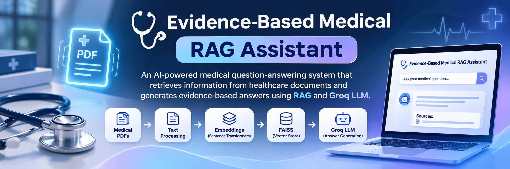
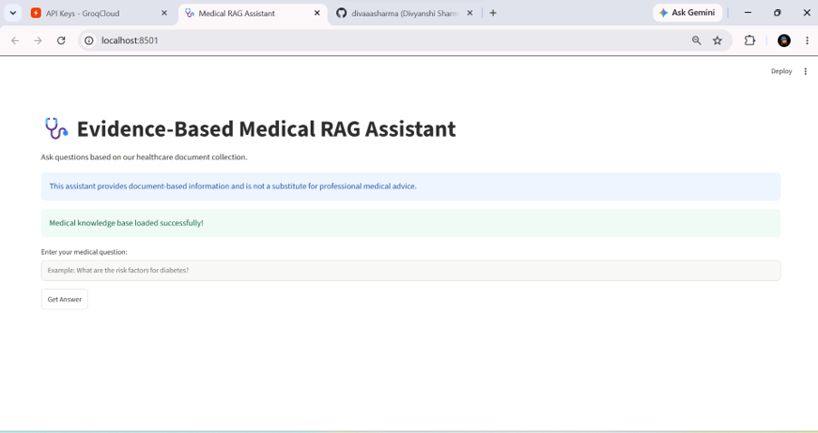
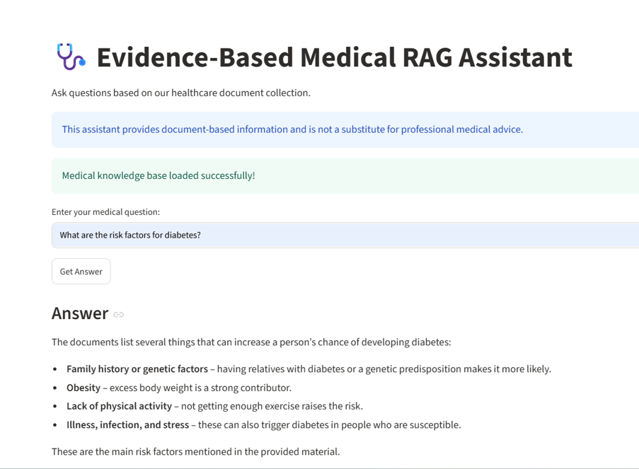
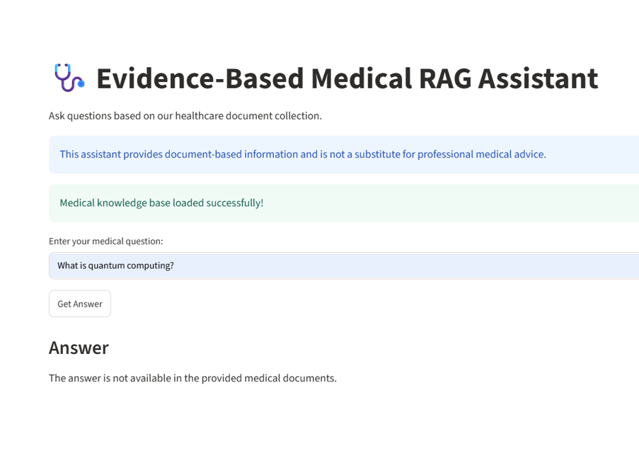

<p align="center">
  
</p>
# 🩺 Evidence-Based Medical RAG Assistant

An AI-powered medical question-answering system that uses Retrieval-Augmented Generation (RAG) to provide evidence-based answers from publicly available healthcare documents.

The system retrieves relevant medical information using semantic search and generates context-grounded responses using Groq LLM.

> **Disclaimer:** This project provides educational, document-based information and is not a substitute for professional medical advice or diagnosis.

## 📌 Project Overview

The Evidence-Based Medical RAG Assistant allows users to ask healthcare-related questions and receive answers based on a collection of medical PDF documents.

Instead of relying entirely on an LLM's pretrained knowledge, the system retrieves relevant passages from its document collection before generating an answer.

If the required information is unavailable in the documents, the assistant explicitly communicates this limitation.

## 🎯 Project Objectives

- Process publicly available healthcare documents.
- Extract and clean text from PDF files.
- Divide documents into overlapping text chunks.
- Generate semantic embeddings.
- Store embeddings using FAISS.
- Retrieve relevant medical passages using similarity search.
- Generate context-grounded answers using Groq.
- Display document sources and page references.
- Handle questions that cannot be answered using the available documents.

## 🏗️ System Architecture

**PDF Documents → Text Extraction → Text Cleaning → Chunking → Embeddings → FAISS Vector Database → Similarity Search → Groq LLM → Final Answer**

## 🛠️ Technologies Used

| Technology | Purpose |
|---|---|
| Python | Core programming language |
| PyPDF | PDF text extraction |
| Pandas & NumPy | Data processing |
| Sentence Transformers | Text embeddings |
| FAISS | Vector storage and similarity search |
| Groq API | LLM-based answer generation |
| Streamlit | Interactive web interface |
| Python-dotenv | Secure environment variable management |

## 📂 Project Structure

```text
Evidence-Based-Medical-RAG-Assistant/
│
├── data/
│   ├── medical_documents/
│   ├── vector_store/
│   ├── processed_documents.json
│   └── document_chunks.json
│
├── src/
│   ├── document_processor.py
│   ├── text_chunker.py
│   ├── vector_store.py
│   ├── retriever.py
│   ├── llm_generator.py
│   └── app.py
│
├── notebooks/
│
├── .env
├── .gitignore
├── requirements.txt
└── README.md
```

## ⚙️ Implementation Workflow

### 1. Document Loading and Extraction
Healthcare PDF documents are loaded using PyPDF. Text is extracted page by page while retaining document names and page numbers.

### 2. Text Cleaning
Extracted text is cleaned to remove unnecessary whitespace and improve consistency.

### 3. Text Chunking
Documents are divided into smaller text segments using:
- Chunk size: 500 words
- Chunk overlap: 100 words

Source filenames and page numbers are preserved.

### 4. Embedding Generation
Sentence Transformers converts text chunks into numerical vector representations using the `all-MiniLM-L6-v2` embedding model.

### 5. Vector Database
FAISS stores the generated embeddings and enables efficient similarity-based retrieval.

### 6. Information Retrieval
When a user submits a question, the system generates a query embedding and retrieves the three most relevant passages.

### 7. LLM-Based Answer Generation
The retrieved passages are supplied as context to Groq's LLM.

The model is instructed to answer using only the provided document information.

### 8. Source Attribution
The application displays the source PDF filename and page number associated with retrieved passages.

### 9. Unavailable Information Handling
If the retrieved documents do not contain sufficient information, the assistant responds:

"The answer is not available in the provided medical documents."

## 🚀 Installation and Setup

### Step 1: Clone the Repository

```bash
git clone YOUR_GITHUB_REPOSITORY_URL
cd Evidence-Based-Medical-RAG-Assistant
```

### Step 2: Create a Virtual Environment

```bash
python -m venv .venv
```

Activate it on Windows:

```bash
.venv\Scripts\activate
```

### Step 3: Install Dependencies

```bash
pip install -r requirements.txt
```

### Step 4: Configure Groq API Key

Create a `.env` file in the project root:

```env
GROQ_API_KEY=your_groq_api_key
```

Never upload your API key to GitHub.

### Step 5: Process Documents

Run the following commands from the project root:

```bash
python src/document_processor.py
python src/text_chunker.py
python src/vector_store.py
```

### Step 6: Launch the Application

```bash
python -m streamlit run src/app.py
```

Open the local URL displayed in the terminal.

## 🧪 Testing

The application was tested using:

| Test | Expected Behaviour |
|---|---|
| Diabetes-related question | Retrieve relevant medical information and generate an answer |
| Hypertension-related question | Retrieve relevant passages and generate an answer |
| Unrelated question | Return an unavailable-information response |

## 🔐 Security

- API credentials are stored in a local `.env` file.
- `.env` is excluded through `.gitignore`.
- Virtual environments and Python cache files are excluded from version control.

## ⚠️ Limitations

- Answers depend on the information available in the uploaded documents.
- PDF extraction quality can affect retrieval accuracy.
- Similarity-based retrieval does not guarantee medical correctness.
- Generated responses should not replace professional medical consultation.

## 🔮 Future Enhancements

- Expand the healthcare document collection.
- Improve retrieval accuracy using reranking.
- Add conversation history.
- Implement document-level filtering.
- Add evaluation metrics for retrieval and answer quality.
- Deploy the application online.

## 👩‍💻 Author

**Divyanshi Sharma**

MBA – Artificial Intelligence & Data Science

GitHub: [Your GitHub Profile](https://github.com/divaaasharma)
## 📸 Application Screenshots

### 1. Application Interface


### 2. Medical Answer Generation


### 3. Handling Unavailable Information
